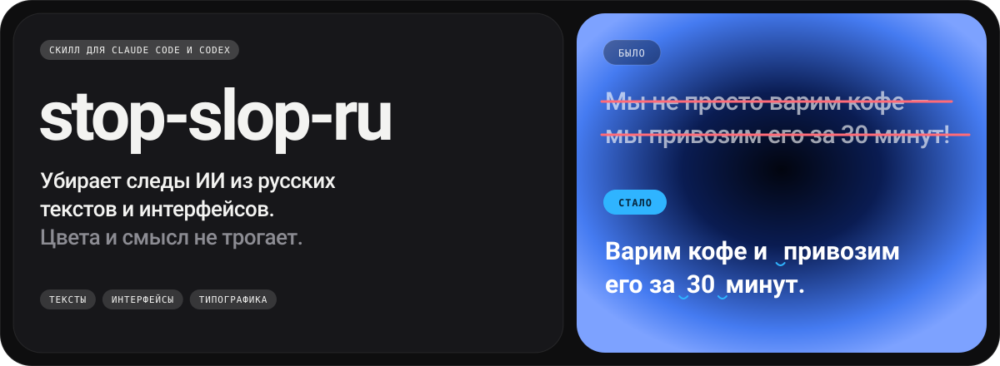
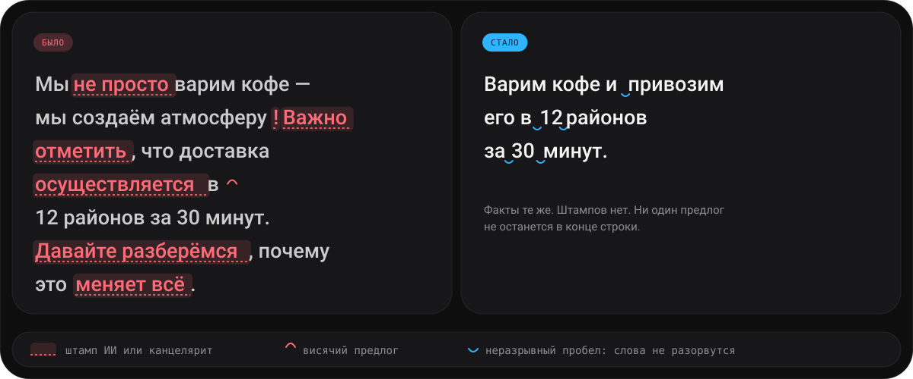
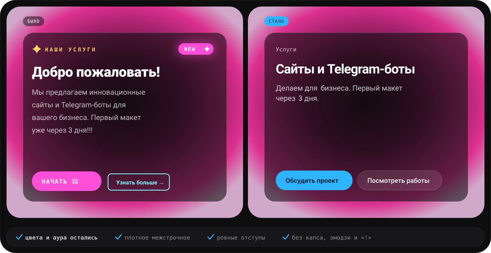
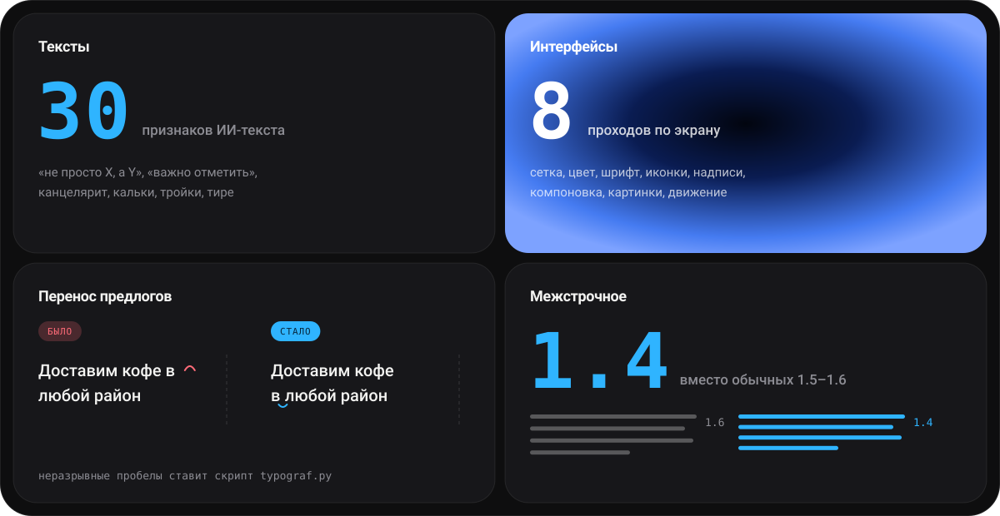

<p align="center"></p>

# stop-slop-ru

Скилл для Claude Code и Codex. Делает так, чтобы русский текст или экран сайта не выглядел написанным нейросетью.

- **Тексты.** Убирает штампы ИИ: «не просто X, а Y», «важно отметить», «давайте разберёмся», канцелярит, кальки с английского, восклицания. Факты, цифры и имена остаются на месте, новые не добавляются.
- **Интерфейсы.** Наводит порядок в отступах, шрифтах, иконках и надписях. **Цвета, градиенты и ауры не трогает.**
- **Типографика.** Предлоги не висят в конце строки, кавычки «ёлочки», правильные тире, межстрочное расстояние чуть плотнее обычного.

## Тексты



30 признаков ИИ-текста в шести группах: пустые конструкции («не просто X, а Y», разгон «давайте разберёмся», концовки-лозунги), ритм по шаблону (тройки, тире вместо точки, деепричастные хвосты), раздувание (штампы, канцелярит, кальки, безымянные «эксперты»), оформление (жирные подписи, эмодзи, «Вы» с заглавной), следы чата («Отличный вопрос!») и ответы не тому читателю.

Скилл не выдумывает. Если в тексте не было цифры, её не будет и после.

## Интерфейсы



Восемь проходов по экрану: сетка и отступы, цвет, шрифт и межстрочное, иконки, надписи, компоновка, картинки, движение. Перед правками скилл записывает характер продукта, чтобы экран не превратился в очередной шаблон.

> **Цвета остаются.** Градиенты, свечения, цветные фоны и цвета бренда не удаляются и не заменяются. Если текст плохо читается на цвете, меняется цвет или подложка текста, а не фон. Если цвет реально мешает, скилл спросит, а не уберёт.

## Что внутри



**Межстрочное расстояние** чуть плотнее привычного: абзацы `1.4` вместо `1.5–1.6`, заголовки `1.1`, крупный заголовок `1.0`. Ниже `1.3` для абзацев не опускается, иначе у кириллицы слипаются «д», «у», «р».

**Перенос предлогов.** Скрипт ставит неразрывный пробел после «в», «и», «на», «с», «к», «не» и других коротких слов, перед тире, между числом и единицей («10 км», «5 000 ₽»), в инициалах и датах:

```bash
python3 scripts/typograf.py текст.md            # результат на экран
python3 scripts/typograf.py текст.md -i         # исправить файл
python3 scripts/typograf.py страница.html --html -i   # только текст между тегами, &nbsp;
```

Код, ссылки, e-mail и содержимое `<script>`, `<style>`, `<code>` скрипт не трогает.

## Установка

**Claude Code**

```bash
git clone https://github.com/oknehcvark/stop-slop-ru ~/.claude/skills/stop-slop-ru
```

**Codex**

```bash
git clone https://github.com/oknehcvark/stop-slop-ru ~/.agents/skills/stop-slop-ru
```

**Claude в браузере или приложении.** Скачайте ZIP (зелёная кнопка Code → Download ZIP) и загрузите его в настройках Claude, раздел «Навыки» (Skills).

Обновить: `git pull` в папке скилла.

## Как пользоваться

Просто попросите своими словами:

- «Очеловечь этот текст» и вставьте текст
- «Убери ИИ из описаний на странице `index.html`»
- «Причеши этот экран, цвета не трогай» и дайте файл или скриншот
- «Расставь неразрывные пробелы в статье»

Скилл сам поймёт, текст это или интерфейс. Если вы пишете с тире или короткими фразами, дайте образец своего текста: скилл подстроится под вашу манеру.

## Лицензия

MIT, автор oknehcvark.

Благодарность: идеи вдохновлены скиллами humanizer (Siqi Chen) и unslop (Damir Sokolovsky).

---

**English.** stop-slop-ru removes AI tells from Russian text and UI: 30 patterns for prose, 8 passes for interfaces, Russian typography (non-breaking spaces after short prepositions, «guillemets», dashes) and a slightly tighter line height. It never removes colors, gradients or glows. Install: `git clone https://github.com/oknehcvark/stop-slop-ru ~/.claude/skills/stop-slop-ru`.
